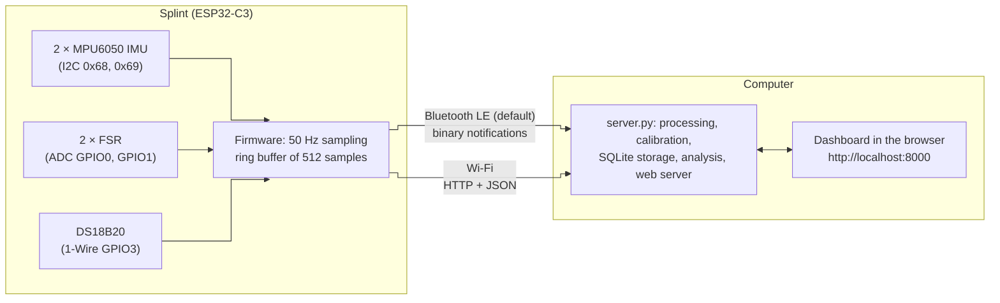
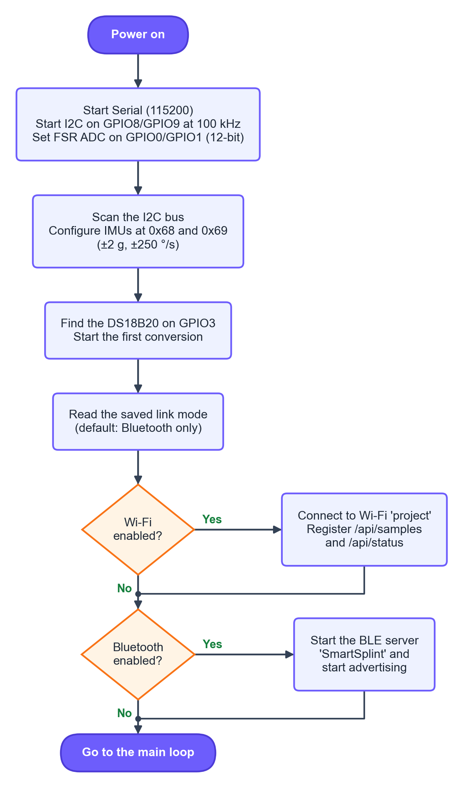
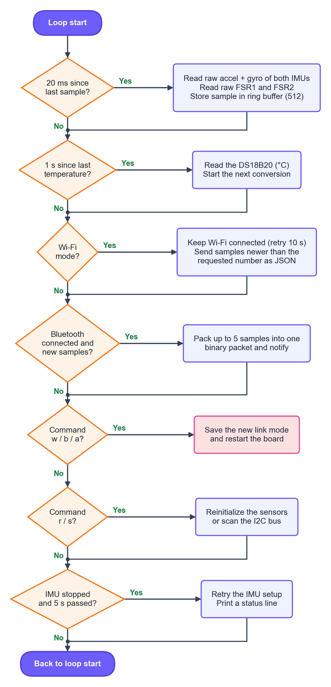
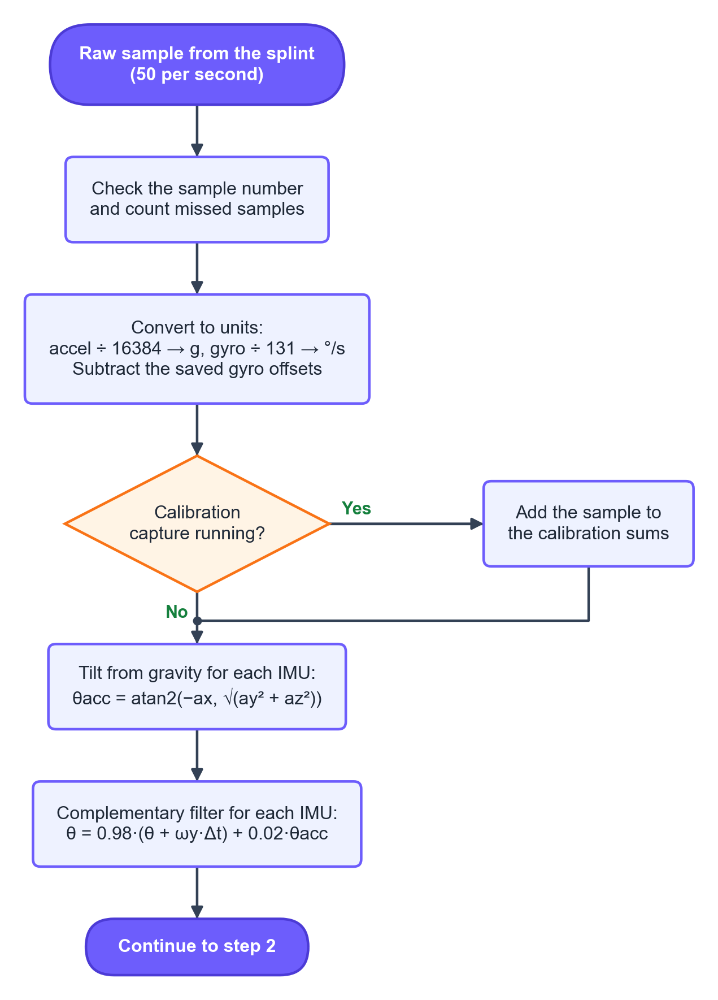
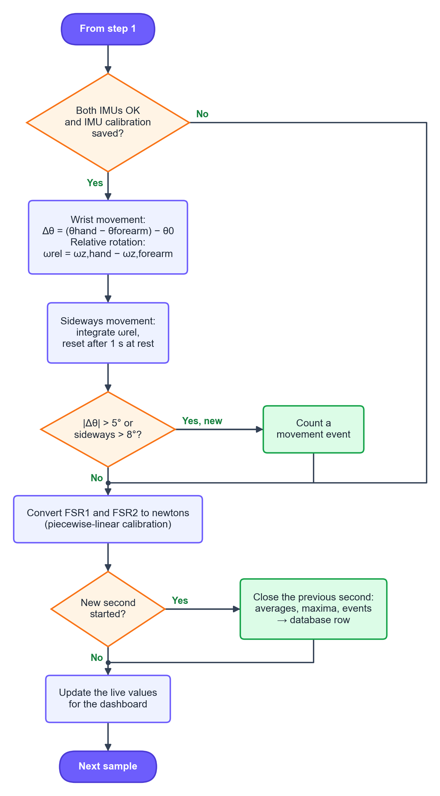
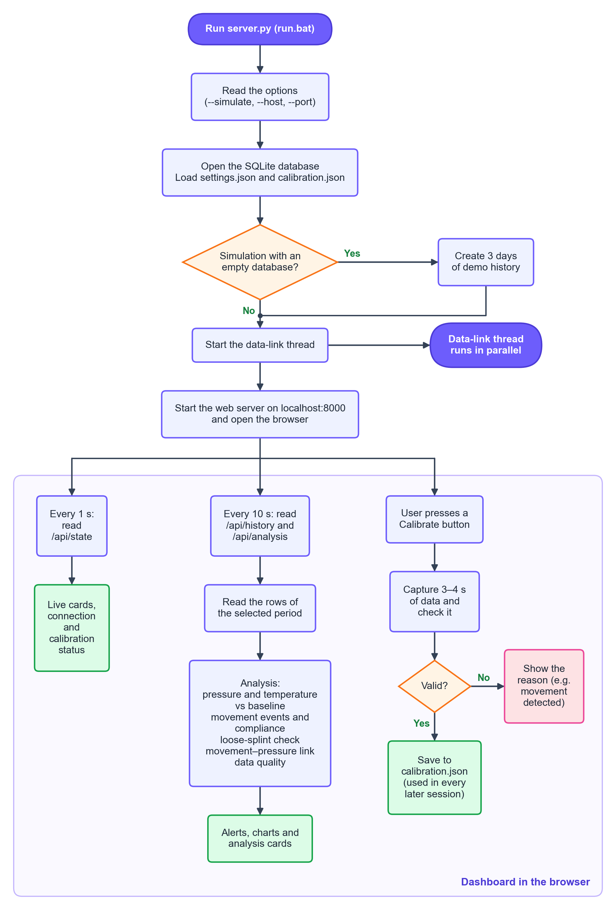
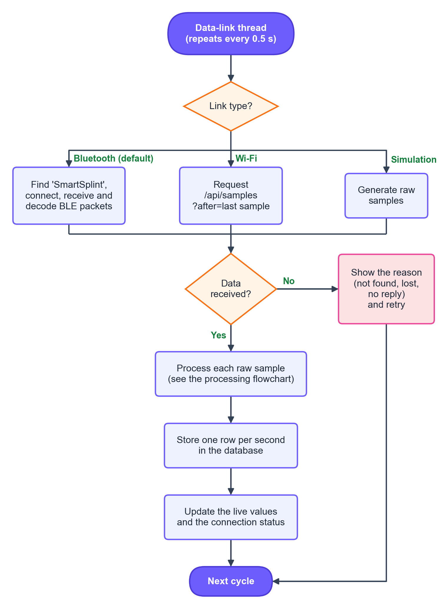

# Smart Orthopedic Splint: Code Documentation

This document describes the two programs of the monitoring system:

| Part | Location | Language | Runs on |
|---|---|---|---|
| **Firmware** | `firmware/SmartSplint_Monitor_FW/SmartSplint_Monitor_FW.ino` | C++ (Arduino) | ESP32-C3 SuperMini on the splint |
| **Computer application** (SmartSplint Monitor) | `SmartSplint_Monitor/` (`server.py` + `static/`) | Python 3 + HTML/CSS/JavaScript | The clinician's computer |

The main design rule is that **the splint only acquires and sends raw data, and the computer does all the processing**:
unit conversion, calibration, filtering, wrist angle, movement events, storage and analysis. This keeps the firmware
simple and lets the calibration and analysis change without reprogramming the splint.

Flowcharts (PNG and SVG) are in `docs/flowcharts/` and are drawn by `draw_flowcharts.py`
(run `python draw_flowcharts.py` after editing it). They are explained in
`Smart Orthopedic Splint - Software Flowcharts.docx`.

| Figure | File |
|---|---|
| ESP32 firmware: setup | `1a_esp32_setup.png` |
| ESP32 firmware: main loop | `1b_esp32_main_loop.png` |
| Application: startup and dashboard | `2a_app_startup_dashboard.png` |
| Application: data-link thread | `2b_app_data_link.png` |
| Processing step 1: conversion and filtering | `3a_processing_convert_filter.png` |
| Processing step 2: wrist movement, events and storage | `3b_processing_wrist_events_storage.png` |

---

## 1. System overview



| Item | Value |
|---|---|
| Sampling rate | 50 samples/s (every 20 ms) for both IMUs and both FSRs, 1 sample/s for temperature |
| Raw sample | `seq, t_ms, forearm ax ay az gx gy gz, hand ax ay az gx gy gz, fsr1, fsr2, flags` |
| Buffer on the splint | 512 samples (about 10 s), so short link interruptions do not lose data over Wi-Fi |
| Default link | Bluetooth Low Energy (lowest power). Wi-Fi is selectable |
| Stored on the computer | One row per second (averages, maxima, event count) in SQLite |

---

## 2. Firmware (ESP32-C3)

### 2.1 Board settings and libraries

| Setting | Value |
|---|---|
| Board | ESP32C3 Dev Module (ESP32 Arduino core 2.0.17) |
| USB CDC On Boot | Enabled (needed for the Serial Monitor) |
| **Partition Scheme** | **Huge APP (3MB No OTA)**. Wi-Fi + BLE together need 1.48 MB, which does not fit the default 1.3 MB partition |
| Libraries | WiFi, WebServer, ESPmDNS, Wire, Preferences, BLEDevice (all in the core); OneWire, DallasTemperature (installed) |
| Program size | 1,481,728 bytes (47% of 3 MB); RAM 83 KB (25%) |

### 2.2 Wiring

| Signal | ESP32-C3 pin | Notes |
|---|---|---|
| IMU SDA / SCL (both IMUs) | GPIO8 / GPIO9 | I2C at 100 kHz |
| Forearm IMU address | 0x68 | AD0 → GND |
| Hand IMU address | 0x69 | AD0 → 3.3 V |
| FSR1 (back of hand) | GPIO0 | Divider: 3.3 V → FSR → pin → 10 kΩ → GND |
| FSR2 (wrist) | GPIO1 | Same divider |
| DS18B20 data | GPIO3 | 4.7 kΩ pull-up to 3.3 V |

Do not use **GPIO2** for an FSR. It is a boot strapping pin, and the 10 kΩ pull-down can stop the board from
starting. GPIO8 also drives the on-board LED, so the LED is not used.

### 2.3 Timing and constants

| Constant | Value | Meaning |
|---|---|---|
| `SAMPLE_MS` | 20 | One sample every 20 ms (50 Hz) |
| `TEMP_MS` | 1000 | DS18B20 read once per second (12-bit conversion takes up to 750 ms) |
| `BUFFER_SIZE` | 512 | Ring buffer length (about 10 s) |
| `MAX_ROWS_PER_REQUEST` | 250 | Maximum samples per Wi-Fi reply |
| IMU range | ±2 g, ±250 °/s | 16384 LSB/g and 131 LSB/(°/s) |
| IMU registers | `0x6B=0x01`, `0x6C=0x00`, `0x1A=0x03`, `0x19=4`, `0x1B=0x00`, `0x1C=0x00` | Wake, all axes on, 44 Hz anti-alias filter, 200 Hz internal rate, ranges |

### 2.4 Main functions

| Function | Purpose |
|---|---|
| `setup()` | Starts Serial, I2C and ADC, initializes the sensors, reads the saved link mode, starts Wi-Fi and/or BLE |
| `loop()` | Takes a sample every 20 ms, reads the temperature every second, services Wi-Fi/BLE and Serial commands, retries stopped IMUs every 5 s |
| `initIMU(i)` | Checks the IMU's identity (`WHO_AM_I`), writes the configuration and reads it back to confirm it |
| `readImuRaw(i)` | Reads 14 bytes from register `0x3B` and returns the 6 raw values (accel X/Y/Z, gyro X/Y/Z) |
| `takeSample()` | Reads both IMUs and both FSRs and stores one `Sample` in the ring buffer. After 10 failed reads in a row an IMU is marked not ready |
| `initializeTemperature()` | Finds the DS18B20, sets 12-bit resolution and starts non-blocking conversions |
| `handleSamples()` | Wi-Fi: `GET /api/samples?after=<seq>` returns the samples newer than `seq` as JSON |
| `handleStatus()` | Wi-Fi: `GET /api/status` returns device information and the latest sample |
| `serviceWiFi()` | Starts or stops the web server and mDNS when Wi-Fi connects or drops, and retries every 10 s |
| `startBLE()` | Creates the BLE server, the data service and its notify characteristic, and starts advertising |
| `serviceBLE()` | Packs up to 5 new samples into one binary packet and sends it as a notification |
| `setLinkMode(mode)` | Saves Wi-Fi / BLE / both in flash (Preferences) and restarts the board |

### 2.5 Wi-Fi interface

- Network `project`, password `12345678`, hostname `smartsplint` (`http://smartsplint.local`).
- `GET /api/samples?after=<seq>` returns:

```json
{
  "firmware": "SmartSplint_Monitor_FW 2.0 (raw)", "ip": "192.168.x.x", "rssi": -55, "uptime_ms": 123456,
  "rate_hz": 50, "accel_lsb_per_g": 16384, "gyro_lsb_per_dps": 131, "adc_bits": 12,
  "imu_ready": [true, true], "temp_found": true, "temp_c": 33.62,
  "fields": ["seq","t_ms","f_ax","f_ay","f_az","f_gx","f_gy","f_gz","h_ax","h_ay","h_az","h_gx","h_gy","h_gz","fsr1","fsr2","flags"],
  "oldest_seq": 1201, "newest_seq": 1712,
  "rows": [[1690, 33800, 120, -40, 16210, 15, -8, 3, 210, 35, 14900, -11, 6, 2, 1873, 1679, 3], "..."]
}
```

`flags`: bit 0 = forearm IMU read OK, bit 1 = hand IMU read OK.

### 2.6 Bluetooth Low Energy interface (default)

| Item | Value |
|---|---|
| Device name | `SmartSplint` |
| Service UUID | `6e7a0001-5a3b-4c8e-9f21-7d4a2c1b0e01` |
| Data characteristic (notify) | `6e7a0002-5a3b-4c8e-9f21-7d4a2c1b0e01` |
| MTU | 247 requested. The number of samples per packet adapts to the negotiated MTU |
| Rate | One packet as soon as 5 samples are waiting, or every 100 ms (about 10 packets/s) |

Packet layout (little-endian):

| Bytes | Field | Type |
|---|---|---|
| 0 | Version (= 1) | uint8 |
| 1 | Number of samples in the packet (1–5) | uint8 |
| 2 | Status: bit 0 forearm IMU ready, bit 1 hand IMU ready, bit 2 temperature valid | uint8 |
| 3–4 | Temperature × 100 (°C), `0x7FFF` = invalid | int16 |
| 5 | Reserved | uint8 |
| 6 + 37·n | Sample n: `seq` (uint32), `t_ms` (uint32), 6 × int16 forearm, 6 × int16 hand, `fsr1` (uint16), `fsr2` (uint16), `flags` (uint8) | 37 bytes |

### 2.7 Serial commands (115200 baud)

| Command | Action |
|---|---|
| `b` | Bluetooth only (**default**, lowest power), saved and restarts |
| `w` | Wi-Fi only, saved and restarts |
| `a` | Wi-Fi and Bluetooth, saved and restarts |
| `r` | Reinitialize all sensors |
| `s` | Scan the I2C bus (expects 0x68 and 0x69) |

### 2.8 Flowchart





---

## 3. Computer application (SmartSplint Monitor)

### 3.1 Files and how to run

| File | Purpose |
|---|---|
| `server.py` | The whole back end: data link, processing, calibration, database, analysis and web server |
| `static/index.html`, `style.css`, `app.js` | Dashboard: 5 tabs, charts drawn on `<canvas>`, no external libraries (works offline) |
| `run.bat` | Starts the app for the real splint and opens the browser |
| `run_simulation.bat` | Starts the app with simulated raw data and 3 days of demo history |
| `data/splint.db` | SQLite database (one row per second + notes/markers) |
| `data/settings.json` | Saved settings (link type, address, analysis limits, baseline) |
| `data/calibration.json` | **Saved IMU and FSR calibration, reused in every later session** |

Requirements: Python 3.8+ and `pip install bleak` (Bluetooth only). Options:

| Option | Meaning |
|---|---|
| `--simulate` | Run without hardware (separate `*_simulation` database, settings and calibration) |
| `--demo-days N` | With `--simulate`: create N days of history once, in an empty database |
| `--host ADDRESS` | Splint address for Wi-Fi |
| `--port N` | Dashboard port (default 8000) |
| `--no-browser` | Do not open the browser |

### 3.2 Program structure (`server.py`)

| Class / function | Purpose |
|---|---|
| `JsonStore`, `Settings` | Load and save `settings.json` and `calibration.json` (atomic write) |
| `Database` | SQLite access: `samples` table (one row per second) and `markers` table (calibration, baseline, notes) |
| `Processor` | Turns raw 50 Hz samples into angles, events and per-second rows. It also runs the calibration captures |
| `fsr_force()` | Converts an FSR reading to newtons with the saved calibration points |
| `parse_ble_packet()` | Decodes one BLE notification into the same row format as Wi-Fi |
| `DeviceLink` (thread) | Gets data from the splint every 0.5 s by Bluetooth, Wi-Fi or simulation, and passes it to `Processor` |
| `Simulator` | Generates realistic raw samples (arm motion, wrist movements, gyro offsets, FSR loads, temperature) |
| `analyze()` | The analysis: pressure, temperature, movement, compliance, loose splint, movement–pressure link, data quality |
| `downsample()` | Reduces the selected period to at most 600 points for the charts |
| `Handler`, `App` | HTTP server: dashboard files and the JSON API |
| `create_demo_history()` | Simulated history and a demo calibration for testing the analysis |

### 3.3 Data link

| Link | How it works |
|---|---|
| **Bluetooth (default)** | `bleak` finds the device named `SmartSplint` (8 s scan), connects and subscribes to the data characteristic. Packets are decoded and processed every 0.5 s. If no data arrives for 5 s, or the connection drops, it reconnects automatically |
| **Wi-Fi** | Every 0.5 s: `GET /api/samples?after=<last seq>`. Up to 4 requests in a row to catch up after a pause. The address `smartsplint.local` is resolved once and cached for 5 min |
| **Simulation** | `Simulator.batch()` produces the samples for the elapsed time |

Missed samples are detected from gaps in `seq`. A sequence number that goes backwards means the splint restarted,
and the filters are reset.

### 3.4 Processing of each raw sample

| Step | Calculation |
|---|---|
| Units | accel ÷ 16384 → g; gyro ÷ 131 → °/s; minus the saved gyro offsets |
| Tilt from gravity | θacc = atan2(−ax, √(ay² + az²)), with x along the segment and z normal to the back of the hand |
| Complementary filter (each IMU) | θ = α·(θ + ωy·Δt) + (1 − α)·θacc, α = 0.98, Δt from the splint's own timestamps. It restarts from θacc after a gap > 0.5 s |
| Wrist movement | Δθ = (θhand − θforearm) − θ0, where θ0 is the fitted angle saved at calibration. Whole-arm movement cancels out |
| Sideways movement | ωrel = ωz,hand − ωz,forearm, integrated over time. Reset to 0 after 1 s with \|ωrel\| < 3 °/s |
| Movement event | Starts when \|Δθ\| > 5° or \|sideways\| > 8°. Ends after 0.5 s with both below 60% of their limits |
| FSR force | Piecewise-linear interpolation between the calibration points (zero → 0 N), extrapolated above the last point |
| Storage | Each second: mean FSR readings and forces, temperature, mean angles, maximum \|Δθ\| and \|ωrel\|, event count, IMU availability, samples received and missed |





### 3.5 Calibration (saved in `calibration.json`)

| Calibration | Procedure | Check | Saved |
|---|---|---|---|
| **IMU** | Splint fitted, arm still, press Start (3 s capture) | ≥ 80% of samples with both IMUs OK; gyro standard deviation ≤ 2 °/s (otherwise "movement detected") | Gyro offsets of both IMUs (mean gyro), reference wrist angle θ0 (from the mean gravity direction) |
| **FSR zero** | No load, press Record zero (4 s) | Enough samples | Mean no-load reading |
| **FSR point** | Known weight on the sensor, enter grams, press Record weight (4 s) | Zero recorded first; reading at least 20 above zero | Point (reading, force in N). Older points that contradict it are removed |

Every capture ignores its first 0.3 s, because pressing the button can move the arm. Example file:

```json
{
  "imu": {"gyro_bias_dps": [[1.615, -0.893, 0.688], [-1.294, 1.102, -0.517]], "reference_deg": 24.995, "time": 1794036956},
  "fsr": [
    {"zero_raw": 2.6, "points": [{"raw": 1280.4, "force_n": 0.981}, {"raw": 2510.1, "force_n": 3.923}], "time": 1794037010},
    null
  ]
}
```

### 3.6 Analysis rules

Default limits can be changed in **Settings**. They were set by the project team and are not clinically validated.

| Analysis | Rule (default values) |
|---|---|
| Baseline | 10 min, starting at the time set with "Start new baseline", otherwise at the start of the selected period |
| Pressure | Median of the last 30 min vs the baseline median. **Alert** if the rise is ≥ 20% **and** ≥ 0.3 N (or ≥ 100 ADC if not calibrated). Uses newtons when ≥ 50% of the rows are calibrated |
| Temperature | Same method. **Alert** if the rise is ≥ 1.0 °C |
| Trends | Least-squares slope per hour (pressure and temperature) |
| Movement | Number of events, events per hour, largest movement. **Alert** if > 6 events per hour |
| Compliance | 100% − % of seconds with maximum \|Δθ\| > 5°. **Alert** if < 95% |
| Loose splint | With ≥ 3 days (≥ 2 h of data each): movements per hour, day by day. **Alert** if the last day is ≥ 1.5× the first and the trend is rising. With less data (≥ 6 h, ≥ 5 events): second half vs first half, ≥ 1.5× |
| Movement–pressure link | Pressure peak = reading > 1.15 × its mean over the previous 30 s (and > 0.1 N / 40 ADC). Counts movement seconds with a peak within ±2 s, plus the correlation. **Note** if ≥ 50% coincide (peaks are caused by movement, not swelling) |
| Data quality | Coverage (gaps > 10 s excluded), gaps, samples received/missed, % of time both IMUs worked. **Note** if coverage < 80% |

Pressure and temperature alerts need at least baseline + 30 min of data in the selected period.

### 3.7 HTTP API (used by the dashboard)

| Method | Path | Purpose |
|---|---|---|
| GET | `/` | Dashboard |
| GET | `/api/state` | Connection, live values, settings, calibration, capture progress (polled every 1 s) |
| GET | `/api/history?hours=H` | Chart data for the last H hours (0 = all) |
| GET | `/api/analysis?hours=H` | Analysis results and alerts (polled every 10 s) |
| GET | `/api/export.csv?hours=H` | CSV export of the stored rows |
| POST | `/api/settings` | Save settings (link type, address, limits, patient label) |
| POST | `/api/calibration/start` | `{"kind": "imu" \| "fsr_zero" \| "fsr_point", "fsr": 1\|2, "force_n": N}` |
| GET | `/api/calibration/status` | Capture progress and result |
| POST | `/api/calibration/clear` | `{"part": "imu" \| "fsr1" \| "fsr2"}` |
| POST | `/api/calibration/remove_point` | Remove one FSR calibration point |
| POST | `/api/baseline` | Start a new baseline now |
| POST | `/api/marker` | Save a note |

### 3.8 Database (`samples` table, one row per second)

| Column | Meaning | Unit |
|---|---|---|
| `ts` | Time (Unix seconds) | s |
| `fsr1_raw`, `fsr2_raw` | Mean FSR reading | ADC (0–4095) |
| `fsr1_n`, `fsr2_n` | Mean force (if calibrated) | N |
| `temp_c` | Skin temperature | °C |
| `theta_f`, `theta_h` | Mean filtered forearm and hand angles | ° |
| `wrist_delta` | Mean wrist movement from the fitted position | ° |
| `deviation` | Sideways movement at the end of the second | ° |
| `omega_rel` | Relative rotation rate | °/s |
| `win_max_delta`, `win_max_omega` | Maximum \|Δθ\| and \|ωrel\| in the second | °, °/s |
| `events_total` | Cumulative movement events in this session | count |
| `in_event` | Movement in progress | 0/1 |
| `imu_f_ok`, `imu_h_ok` | Fraction of samples with the IMU working | 0–1 |
| `rssi` | Wi-Fi signal (Wi-Fi only) | dBm |
| `calibrated` | Wrist movement available (IMU calibrated) | 0/1 |
| `n_samples`, `n_missed` | Samples received and missed in the second | count |

### 3.9 Dashboard

| Tab | Content |
|---|---|
| Overview | Overall status, live cards (2 pressures, temperature, wrist movement with gauge, sideways movement, compliance), alerts, notes |
| Charts | Pressure, temperature (with alert level), wrist movement (with limit), movement events. Tooltips on hover |
| Analysis | One card per analysis and the list of findings |
| Calibration | IMU wizard, FSR 1 and FSR 2 wizards (zero + weights in grams, points table), live raw readings |
| Settings | Link type (Bluetooth / Wi-Fi), addresses, patient label, baseline, CSV export, analysis limits |





---

## 4. Testing done

| Test | Result |
|---|---|
| Firmware compile (`esp32:esp32:esp32c3`, Huge APP) | Success, no warnings, 47% flash |
| BLE packet encode → decode | The 191-byte, 5-sample packet decoded exactly |
| FSR conversion | Correct interpolation and extrapolation |
| Whole-arm motion (simulation) | Arm moving ±30°, wrist movement stayed ≈ 0° |
| IMU calibration (simulation) | Recovered the simulated gyro offsets (1.615 vs 1.6 °/s) and the 25.0° reference |
| Analysis (3 days of simulated data) | Rising movement rate detected as a loose splint. Analysis time 0.45 s |
| Dashboard | All 5 tabs checked in light and dark mode |

**Not yet tested:** the new firmware on the real splint, and the Bluetooth link with real hardware.

## 5. Earlier sketches (development history)

| Sketch | Purpose |
|---|---|
| `SmartSplint_WiFiTest_1` | First Wi-Fi connection test with a simple web page |
| `SmartSplint_HardwareTest` | Sensor and wiring diagnostics |
| `SmartSplint_IMUOnly` | Reading both MPU6050s (0x68 and 0x69) |
| `SmartSplint_AllSensors` | All sensors, Serial output only |
| `SmartSplint_AllSensors_WiFi` | All sensors with an on-board web dashboard (values processed on the ESP32) |
| **`SmartSplint_Monitor_FW`** | **Current version: raw data only, Bluetooth (default) + Wi-Fi, for the computer application** |

## 6. Known limitations

- The MPU6050 has no magnetometer. Sideways (radial/ulnar) movement is therefore measured as short movements, not as
  an absolute angle over long periods.
- After a Bluetooth reconnection, samples sent during the dropout are not resent. Over Wi-Fi, up to 10 s are
  recovered from the buffer.
- The sign of the wrist angle depends on how the IMU boxes are mounted. Confirm it with a goniometer (test T3).
- The analysis limits are not clinically validated, and the power use of Wi-Fi vs Bluetooth still has to be measured.
